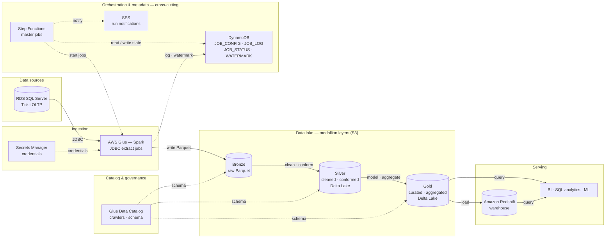

# NT Accelerate Lakehouse — Documentation

This series documents the AWS TechCamp 2022 lakehouse built as Infrastructure-as-Code using Terraform. The lab runs across three days, each adding a layer to the architecture.

| Day | Topic | Status |
|-----|-------|--------|
| [Day 1](./day1-ingestion.md) | Extract data from RDS SQL Server into S3 (bronze layer) using AWS Glue | ✅ Implemented |
| [Day 2](./day2-orchestration.md) | Orchestration — master job, Step Functions, Lambda, SES notifications | ✅ Implemented |
| Day 3 | Transform, gold layer, Redshift migration | 🔜 Planned |

## Architecture

An end-to-end lakehouse following the medallion best practice. Data is ingested from the source system into a **bronze** layer, progressively refined through **silver** and **gold**, and served to analytics — with cataloguing, orchestration, and run metadata applied consistently at every layer.



## Guides

| Guide | Topic |
|-------|-------|
| [Running locally for free](./local-development.md) | LocalStack, the Glue Docker runtime, and a local SQL Server (Azure SQL Edge) — run the pipeline on your laptop with zero cloud cost |

## Repository layout

```
lakehouse/
├── docs/                    ← architecture docs (this folder)
├── infra/                   ← Terraform root module (wires the two day modules)
│   ├── main.tf              — passes Day 1 outputs into the Day 2 module
│   ├── variables.tf         — root inputs, shared by both modules
│   ├── outputs.tf           — re-exports the Day 1 outputs
│   ├── providers.tf         — AWS provider and default tags
│   ├── versions.tf          — Terraform and provider version pins
│   ├── modules/
│   │   ├── day1/            — ingestion layer
│   │   │   ├── networking.tf — VPC, security groups, RDS
│   │   │   ├── s3.tf         — S3 bucket and artifact uploads
│   │   │   ├── iam.tf        — Glue IAM role and policies
│   │   │   ├── secrets.tf    — Secrets Manager
│   │   │   ├── dynamodb.tf   — control tables + seed data
│   │   │   ├── glue.tf       — Glue catalog, connection, crawler
│   │   │   ├── glue_jobs.tf  — Glue extraction jobs
│   │   │   └── rds_seed.tf   — RDS seeding via sqlcmd
│   │   └── day2/            — orchestration layer
│   │       ├── lambda.tf      — orchestration Lambda functions
│   │       ├── sfn.tf         — Step Functions state machines
│   │       ├── dynamodb.tf    — JOB_STATUS / JOB_CONFIG / MAIL_CONFIG tables
│   │       ├── iam.tf         — Lambda and Step Functions roles
│   │       ├── ses.tf         — SES sender/receiver identities
│   │       └── eventbridge.tf — optional daily schedule
│   ├── scripts/
│   │   └── batch_seed.py    — fast batch seed helper (shared with the RDS seed)
│   └── localstack/          — local run harness (no Terraform involved)
└── instruction/             ← original lab source artifacts
```
