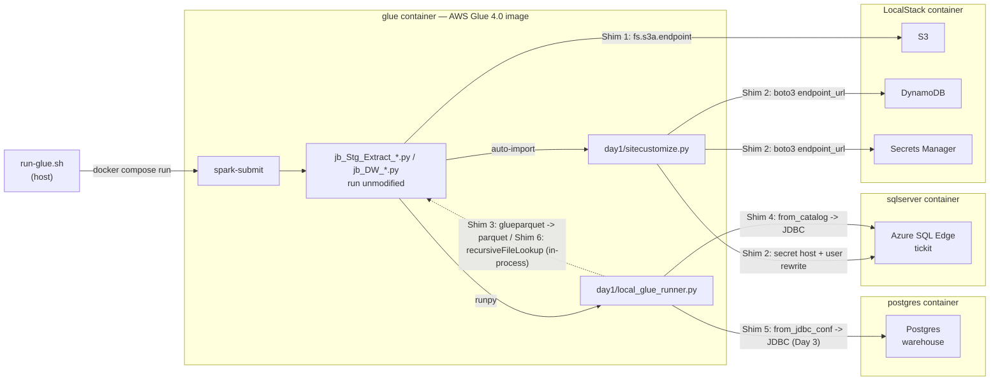
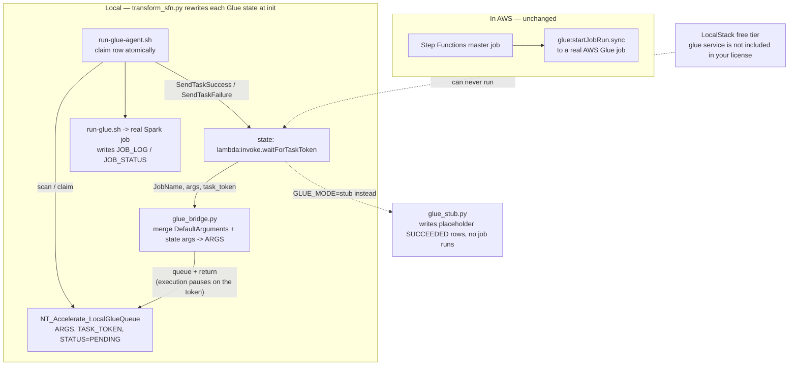

# Running the Lakehouse Locally for Free — LocalStack, Docker, and a Local SQL Server

*Companion guide to the 3-part lakehouse series — how to run the Day 1 pipeline, the Day 2 orchestration, and the Day 3 lakehouse + warehouse transforms entirely on your laptop without an AWS account.*

---

The [Day 1 ingestion post](./day1-ingestion.md) ends with a cost table and a warning: *"the main ongoing cost risk is forgetting to stop RDS."* That warning is real, but it hides a second problem that has nothing to do with money — **you cannot iterate quickly against a cloud stack you have to `terraform apply` and `terraform destroy` every time you change a line of a Glue script.**

So this guide is about a different trade: instead of paying a few cents per session for real AWS services, we stand up the *same* architecture on the laptop. The whole thing is **one `docker compose` file**, and the marginal cost of a run is **zero**.

| Piece | Cloud version | Local version | Local cost |
|-------|---------------|---------------|------------|
| Object storage | S3 | LocalStack S3 | $0 |
| Control plane | DynamoDB | LocalStack DynamoDB | $0 |
| Secrets | Secrets Manager | LocalStack Secrets Manager | $0 |
| Compute | AWS Glue (Spark) | Official Glue Docker image | $0 |
| Delta Lake (Day 3) | Delta on S3 | Delta 2.3.0 on the Glue image (`fetch-jars.sh`) | $0 |
| Warehouse (Day 3) | Amazon Redshift | Postgres container (`nt-postgres`) | $0 |
| Source DB | RDS SQL Server Express | Azure SQL Edge container | $0 |
| Catalog | AWS Glue Data Catalog | ⚠️ license-blocked → bridged to a direct JDBC read/write (see *Known gaps*) | $0 |
| Orchestration (Day 2) | Step Functions + Lambda | LocalStack Step Functions + Lambda | $0 |
| Notifications (Day 2) | SES | LocalStack SES | $0 |

The local stack is completely independent of the cloud one: **it never runs Terraform**, and the files that make it work all live under [`infra/localstack/`](../infra/localstack/). Nothing you do locally changes what `terraform apply` does against real AWS — see [Keeping local and cloud separate](#keeping-local-and-cloud-separate).

---

## Quick start

Three commands from the repo root:

```bash
# 1. Get a free LocalStack auth token from https://app.localstack.cloud
cp infra/localstack/.env.example infra/localstack/.env
$EDITOR infra/localstack/.env          # paste LOCALSTACK_AUTH_TOKEN=...

# 2. Start LocalStack (S3/DynamoDB/Secrets Manager) + the local SQL Server
#    + the Postgres warehouse stand-in
docker compose -f infra/localstack/docker-compose.yml up -d

# 3. Load the Tickit schema + data into the SQL container
#    (one time, ~1–2 min — the data is kept in a named volume, so later
#     `up`/`down` cycles reuse it)
infra/localstack/seed-sql.sh
```

That's the stack. Now run any Day 1 job:

```bash
infra/localstack/run-glue.sh jb_Stg_Extract_Venue.py \
  --JOB_NAME local-venue --p_job_name jb_Stg_Extract_Venue \
  --p_run_date 2026-11-18 --p_batch_id 1 --p_region us-east-1 \
  --p_is_incremental_load False --p_catalog_conn conRDS_tickit \
  --p_src_databaseName tickit --p_src_tableName tickit_dbo_venue \
  --p_tar_databaseName s3://ntaccelerate-hoang-985176/lake/bronze/tickit/ \
  --p_tar_tablename venue
```

And run the Day 2 orchestration — the Step Functions master job that fans out the seven extraction jobs in parallel:

```bash
infra/localstack/run-master-job.sh          # NT_Accelerate_Datalake_Master_Job
```

Then the Day 3 master jobs (Delta + warehouse), in order — see [Running the Day 3 orchestration locally](#running-the-day-3-orchestration-locally):

```bash
infra/localstack/run-master-job.sh NT_Accelerate_LakeHouse_Master_Job
infra/localstack/run-master-job.sh NT_Accelerate_RedshiftDW_Master_Job
```

When you are done:

```bash
docker compose -f infra/localstack/docker-compose.yml down
```

---

## Why local at all — and where it breaks

The honest starting point is that **LocalStack's free tier excludes exactly the two services this lab cares about most**. A healthy-looking instance will still fail at call time:

```bash
$ aws rds describe-db-instances
An error occurred (InternalFailure) when calling the DescribeDBInstances operation:
Sorry, the rds service is not included within your LocalStack license

$ aws glue get-databases
An error occurred (InternalFailure) when calling the GetDatabases operation:
Sorry, the glue service is not included within your LocalStack license
```

Two traps are worth knowing here. First, `/_localstack/health` still lists `rds` and `glue` as `"available"` — the health endpoint reflects whether the *service module loaded*, not whether your *license* permits invoking it. The real gate is at call time, and it returns `InternalFailure`, not `AccessDenied`; if you see `InternalFailure` on a service you just added, check the license before you check the IAM policy.

Second, every current LocalStack image — including the community `localstack/localstack` — **requires an auth token to start at all**, and quits with `License activation failed` without one. The token is free (Settings → Auth Token at [app.localstack.cloud](https://app.localstack.cloud)); it is what the `LOCALSTACK_AUTH_TOKEN` in `.env` is for.

That is the whole reason this guide exists: **Glue and RDS are the expensive parts, and LocalStack won't emulate them.** So we don't ask it to. LocalStack handles S3 + DynamoDB + Secrets Manager (all free); Glue runs as a real container; the database runs as a real container. Nothing is on the cloud, so nothing costs anything.

---

## The stack

### Services

[`infra/localstack/docker-compose.yml`](../infra/localstack/docker-compose.yml) defines four services on one network:

| Service | Image | What it is | Started by |
|---------|-------|------------|------------|
| `localstack` | `localstack/localstack` | S3, DynamoDB, Secrets Manager, **Lambda, Step Functions, SES, EventBridge** on `localhost:4566` | `up -d` |
| `sqlserver` | `mcr.microsoft.com/azure-sql-edge` | The source database on `localhost:1433` | `up -d` |
| `postgres` | `postgres:18` | The Day 3 warehouse stand-in for Redshift on `localhost:5432` | `up -d` |
| `glue` | `public.ecr.aws/glue/aws-glue-libs:glue_libs_4.0.0_image_01` | The Glue/Spark runtime the jobs execute in | `run-glue.sh` (profile `tools`) |

Two design choices matter:

**The `glue` service is behind a profile.** A plain `docker compose up -d` starts only the three long-running services; the job container (a 9 GB image) is started on demand by `run-glue.sh`, which shells out to `docker compose run`. Because everything is on the same compose network, the job reaches LocalStack at `http://localstack:4566`, the database at `sqlserver:1433`, and the warehouse at `postgres:5432` **by service name** — no `host.docker.internal`, no host networking.

**The resources are created by init hooks, not by Terraform.** LocalStack runs every script in `/etc/localstack/init/ready.d/` in name order once its API is up. [`init/01-provision.sh`](../infra/localstack/init/01-provision.sh) creates the Day 1 S3 bucket and its objects, the four DynamoDB control tables and their seed rows, and the JDBC credentials secret. [`init/02-day2.sh`](../infra/localstack/init/02-day2.sh) then provisions the Day 2 control plane: the two new control tables (`MASTER_JOB_CONFIG`, `Mail_Config`), the Day 2 superset of the `JOB_CONFIG` rows, the two IAM roles, the SES identities, the nine orchestration Lambdas (+ two local Glue stand-ins, the bridge and the stub), and the three Step Functions master jobs. [`init/03-day3.sh`](../infra/localstack/init/03-day3.sh) finishes the job: it adds the gold Delta prefix and the twelve Day 3 `JOB_CONFIG` rows (six `LAKEHOUSE`, six `DW`) plus the two extra `MASTER_JOB_CONFIG` rows the Day 3 master jobs read. All three are idempotent, so restarts are safe.

### Files

| File | Purpose |
|------|---------|
| `infra/localstack/docker-compose.yml` | The whole stack |
| `infra/localstack/.env.example` | Config template (copy to `.env`) |
| `infra/localstack/init/01-provision.sh` | LocalStack init hook — S3 + DynamoDB + Secrets Manager |
| `infra/localstack/init/02-day2.sh` | LocalStack init hook — Day 2 tables, Lambdas, state machines |
| `infra/localstack/init/03-day3.sh` | LocalStack init hook — Day 3 gold prefix, `JOB_CONFIG` + `MASTER_JOB_CONFIG` rows |
| `infra/localstack/day1/sitecustomize.py` | Day 1 — routes boto3 + rewrites the JDBC secret |
| `infra/localstack/day1/local_glue_runner.py` | Day 1/3 — `glueparquet` → `parquet`, catalog → JDBC, Redshift → Postgres, Parquet `recursiveFileLookup` |
| `infra/localstack/day2/glue_bridge.py` | Day 2 — queues each Glue step for the local agent (bridge mode; not deployed to AWS) |
| `infra/localstack/day2/glue_job_defaults.json` | Day 2 — the jobs' static Glue `DefaultArguments`, merged by the bridge |
| `infra/localstack/day2/glue_stub.py` | Day 2 — instant stand-in for the Glue step (stub mode; not deployed to AWS) |
| `infra/localstack/day2/transform_sfn.py` | Day 2 — rewrites a master-job JSON for local (Glue→bridge/stub, real ARNs) |
| `infra/localstack/run-glue.sh` | Runs a Day 1 / Day 3 Glue job via `docker compose run` |
| `infra/localstack/fetch-jars.sh` | Day 3 — downloads the Delta 2.3.0 JARs into `jars/` (called by `run-glue.sh`) |
| `infra/localstack/run-glue-agent.sh` | Day 2 — drains the Glue hand-off queue and runs the real jobs |
| `infra/localstack/run-master-job.sh` | Runs a Day 2 / Day 3 Step Functions master job |
| `infra/localstack/seed-sql.sh` | Loads Tickit into the SQL container (host side) |

### Configuration

Everything is optional except the token. Compose reads `infra/localstack/.env` automatically:

| Variable | Default | Notes |
|----------|---------|-------|
| `LOCALSTACK_AUTH_TOKEN` | — | **Required.** Free token from app.localstack.cloud |
| `MSSQL_SA_PASSWORD` | `MyPass123!` | Password for the container's `sa` login (local throwaway) |
| `PG_PASSWORD` | `MyPass123!` | Password for the warehouse Postgres `postgres` login (local throwaway) |
| `BUCKET_NAME` | `ntaccelerate-hoang-985176` | The bucket the jobs read/write |
| `AWS_DEFAULT_REGION` | `us-east-1` | Region the stack pretends to be in |
| `MAIL_SENDER` | `elt.sender@example.com` | Day 2 notification sender (verified in SES) |
| `MAIL_RECEIVERS` | `elt.receiver@example.com` | Day 2 notification recipients (comma-separated) |
| `GLUE_MODE` | `bridge` | How the Day 2 Glue steps are stood in for (`bridge` or `stub`); only read on the next `up` |

`.env` is gitignored; `.env.example` is committed. Everything else — image, mounts, endpoints, credentials — is wired in the compose file.

---

## Keeping local and cloud separate

The local path was deliberately built so that **no `.tf` or `.py` file changes behaviour under `terraform apply`**:

* **The local stack never runs Terraform.** The bucket, tables, and secret are created by the init hook, and Glue/RDS are replaced by containers. That is why this guide needs no `*_override.tf` files — there is nothing to create before a local run and nothing to remember to delete before a real one. (Earlier versions of this harness worked by *overriding* the Terraform config to point at LocalStack; those files are gone.)
* **The Glue scripts are unmodified.** Every difference between local and cloud is absorbed at runtime, by the two files under `infra/localstack/day1/` (see below), which are mounted read-only into the job container only.
* **The one `.py` shared with the cloud path** is [`infra/scripts/batch_seed.py`](../infra/scripts/batch_seed.py), used by both `terraform apply` (against RDS) and `seed-sql.sh` (against the container). Its local-only behaviour is behind an opt-in `--no-encrypt` flag, so the default — and therefore the RDS path — is unchanged.

In short: `git diff` on the Terraform is what you deploy; `infra/localstack/` is a parallel way to run the same jobs.

---

## Running Glue locally

The trick is that AWS publishes the **actual Glue runtime** as a container image:

```
public.ecr.aws/glue/aws-glue-libs:glue_libs_4.0.0_image_01
```

Running our `jb_Stg_Extract_*.py` (Day 1) and `jb_DW_*` (Day 3) scripts inside it — unmodified — with `spark-submit` gives us the same Glue/Spark behaviour AWS uses, for free. A few small shims make the unmodified scripts work. They intercept everything the job would normally hand to *managed* Glue and point it at a local container instead:



### Shim 1 — remap `s3://` to LocalStack's S3A endpoint

The image's Spark must believe `s3://` is served by LocalStack. [`run-glue.sh`](../infra/localstack/run-glue.sh) passes the S3A configuration on the `spark-submit` command line:

```
--conf spark.hadoop.fs.s3.impl=org.apache.hadoop.fs.s3a.S3AFileSystem
--conf spark.hadoop.fs.s3a.endpoint=http://localstack:4566
--conf spark.hadoop.fs.s3a.path.style.access=true
--conf spark.hadoop.fs.s3a.connection.ssl.enabled=false
--conf spark.hadoop.fs.s3a.access.key=test
--conf spark.hadoop.fs.s3a.secret.key=test
```

The endpoint is the compose service name, so the job container and LocalStack just talk to each other over the compose network.

### Shim 2 — old boto3 doesn't know `AWS_ENDPOINT_URL`

The Glue 4.0 image ships **boto3 1.24 / botocore 1.27**, which predate the `AWS_ENDPOINT_URL` environment variable. So the Glue scripts' boto3 calls would go to real AWS. [`sitecustomize.py`](../infra/localstack/day1/sitecustomize.py) is auto-imported at interpreter start and monkey-patches `boto3.client` / `boto3.resource` to inject `endpoint_url` for the services the jobs use — **DynamoDB** (job log, watermark, status) and **Secrets Manager** (the JDBC credentials):

```python
_ROUTED = {"dynamodb", "secretsmanager"}

def _client(*args, **kwargs):
    service = args[0] if args else kwargs.get("service_name")
    if service in _ROUTED:
        kwargs.setdefault("endpoint_url", _endpoint)
        kwargs.setdefault("region_name", os.environ.get("AWS_DEFAULT_REGION", "us-east-1"))
    return _orig_client(*args, **kwargs)
```

The same shim also **rewrites the values inside the JDBC secret**, because the secret mirrors the *cloud* RDS instance while the job connects to the *local* container. Two things differ and both are fixed on the way out of `GetSecretValue`:

* **`db_url` host** — the stored URL points at `localhost:1433` (the host's view). From inside the job container that address is the container itself, so it is rewritten to `sqlserver`, and `encrypt=false;trustServerCertificate=true` is appended (the local SQL Server's self-signed certificate has a negative serial number the JDBC TLS layer rejects).
* **`db_username`** — the secret stores the RDS master user (`admin`), but the local container's master login is `sa`. Mapping the secret onto `sa` keeps the scripts unmodified and means no extra SQL login has to be provisioned locally.

Both rewrites are opt-in via `LOCAL_SECRET_JDBC_HOST` / `LOCAL_SECRET_JDBC_USER` (set in the compose file):

```python
def _rewrite_secret(response):
    secret = json.loads(response["SecretString"])
    if _secret_user:
        secret["db_username"] = _secret_user
    url = secret.get("db_url")
    if url and "jdbc:sqlserver://" in url:
        url = re.sub(r"//(localhost|127\.0\.0\.1)(:\d+)", rf"//{_secret_host}\2", url)
        if "encrypt=" not in url:
            url += ";encrypt=false;trustServerCertificate=true"
        secret["db_url"] = url
    response["SecretString"] = json.dumps(secret)
    return response
```

### Shim 3 — `glueparquet` doesn't exist outside managed Glue

The Glue scripts write with `format="glueparquet"`, a **proprietary writer that only exists inside the managed Glue service**. In the open-source/local runtime it raises:

```
java.lang.RuntimeException: glueparquet format not supported for developer environment
```

The ETL logic is unaffected — only the optimized writer is missing. Rather than edit the shipped scripts, [`local_glue_runner.py`](../infra/localstack/day1/local_glue_runner.py) wraps `DynamicFrameWriter.from_options`, swaps `glueparquet` → Spark's standard `parquet`, and then `runpy`-executes the real script:

```python
def _from_options(*args, **kwargs):
    bound = _sig.bind(*args, **kwargs)
    if str(bound.arguments.get("format", "")).lower() == "glueparquet":
        bound.arguments["format"] = "parquet"
        print("[local-glue] glueparquet -> parquet (local dev shim)")
    return _orig_from_options(*bound.args, **bound.kwargs)
```

### Shim 4 — Glue Data Catalog → direct JDBC read

The six full-load jobs read their source through `glueContext.create_dynamic_frame.from_catalog(...)`, which needs the Glue Data Catalog — again **license-blocked**. [`local_glue_runner.py`](../infra/localstack/day1/local_glue_runner.py) patches `DynamicFrameReader.from_catalog` so that a catalog reference like `tickit.tickit_dbo_venue` becomes a **direct Spark JDBC read** of the same table in the local SQL Server. The crawler names catalog tables `<db>_<schema>_<table>`, so the table name is parsed back into schema + table:

```python
def _parse_catalog_table(database, table_name):
    """tickit_dbo_venue -> ('dbo', 'venue')"""
    rest = table_name or ""
    prefix = f"{database}_"
    if rest.startswith(prefix):
        rest = rest[len(prefix):]
    schema, sep, table = rest.partition("_")
    return (schema, table) if sep else None

def _from_catalog(self, database=None, table_name=None, **kwargs):
    target = _parse_catalog_table(database, table_name)
    if not target:
        return _orig_from_catalog(self, database=database, table_name=table_name, **kwargs)
    schema, table = target
    glue_ctx = self._glue_context
    print(f"[local-glue] from_catalog {database}.{table_name} -> JDBC [{schema}].[{table}]")
    df = (glue_ctx.spark_session.read.format("jdbc")
          .option("url", _LOCAL_JDBC)
          .option("dbtable", f"[{schema}].[{table}]")
          .option("user", os.environ["LOCAL_CATALOG_USER"])
          .option("password", os.environ["LOCAL_CATALOG_PASSWORD"])
          .option("driver", "com.microsoft.sqlserver.jdbc.SQLServerDriver")
          .load())
    return _df.DynamicFrame.fromDF(df, glue_ctx, table_name or table)
```

The JDBC connection comes from `LOCAL_CATALOG_JDBC` / `LOCAL_CATALOG_USER` / `LOCAL_CATALOG_PASSWORD` (set in the compose file). With this bridge in place, **every** Day 1 job — the six full-load jobs and the incremental Sales job — runs end-to-end locally against S3 + DynamoDB + the SQL Server container.

### Shim 5 — Redshift `from_jdbc_conf` → direct JDBC write (Day 3)

The six `jb_DW_Redshift_Load_*` jobs load their target through the Glue Data Catalog *connection* `conRedshift_tickit`:

```python
glueContext.write_dynamic_frame.from_jdbc_conf(
    frame=dfSource, catalog_connection=var_catalog_con,
    connection_options={"dbtable": var_tar_table, ...},
    redshift_tmp_dir=var_redshift_temp, transformation_ctx="redshift_datasink")
```

There is no catalog locally, and **LocalStack's free tier does not emulate Redshift**, so [`local_glue_runner.py`](../infra/localstack/day1/local_glue_runner.py) patches `DynamicFrameWriter.from_jdbc_conf` to perform a plain Spark JDBC write against the `postgres` container. The preactions (`drop table if exists <target>`) and postactions (`analyze <target>`) are covered by `mode("overwrite")` / skipped:

```python
(frame.toDF().write.format("jdbc")
    .option("url", _LOCAL_REDSHIFT).option("dbtable", table)
    .option("user", os.environ["LOCAL_REDSHIFT_USER"])
    .option("password", os.environ["LOCAL_REDSHIFT_PASSWORD"])
    .option("driver", "org.postgresql.Driver").mode("overwrite").save())
```

The connection comes from `LOCAL_REDSHIFT_JDBC` / `LOCAL_REDSHIFT_USER` / `LOCAL_REDSHIFT_PASSWORD` (set in the compose file). The Postgres JDBC driver ships with the Glue image, so no extra JAR is needed.

### Shim 6 — Parquet reads over a prefix of directories (`recursiveFileLookup`)

The Day 3 jobs read the Day 1 bronze prefix, whose *immediate children are directories* (`lake/bronze/tickit/<table>/<run_date>/`). Against LocalStack S3, Spark's default leaf-file listing finds no files for such a prefix and schema inference fails:

```
Unable to infer schema for Parquet. It must be specified manually.
```

Reading a directory that directly contains part-files works, so the failure depends only on the prefix's children being directories — not on naming, and not on S3A (its own `listStatus` enumerates the leaf part-file correctly). [`local_glue_runner.py`](../infra/localstack/day1/local_glue_runner.py) therefore forces `recursiveFileLookup=true` on every `s3://` Parquet read, so Spark descends into the date directories:

```python
def _parquet(self, *paths, **options):
    if any(str(p).startswith(("s3://", "s3a://")) for p in paths):
        options.setdefault("recursiveFileLookup", "true")
    return _orig_parquet(self, *paths, **options)
```

The bronze data carries no partition columns (Day 1 writes `partitionKeys: []`), so turning off partition discovery is harmless.

### Running a job

`run-glue.sh` mounts the Glue scripts, the shared `library/`, the `raw/` landing zone, and `day1/` read-only into the container, runs a **login shell** (so `.bashrc` sets `SPARK_HOME`, `PYTHONPATH`, and `PyGlue.zip`, which `import awsglue` needs), pip-installs the extras the flat-file job needs (`openpyxl==3.0.10`), and finally invokes `spark-submit`:

```bash
# the flat-file job (reads a file from the raw/ landing zone)
infra/localstack/run-glue.sh jb_Stg_Extract_ExcelFile.py \
  --JOB_NAME local-excel --p_job_name jb_Stg_Extract_ExcelFile \
  --p_run_date 2026-11-18 --p_batch_id 1 --p_region us-east-1 \
  --p_src_databaseName /home/glue_user/workspace/raw/excel/ \
  --p_src_tableName SalesEvent.xlsx \
  --p_tar_databaseName s3://ntaccelerate-hoang-985176/lake/bronze/tickit/ \
  --p_tar_tablename salesevent

# a full-load job (reads via the catalog -> JDBC bridge)
infra/localstack/run-glue.sh jb_Stg_Extract_Venue.py \
  --JOB_NAME local-venue --p_job_name jb_Stg_Extract_Venue \
  --p_run_date 2026-11-18 --p_batch_id 1 --p_region us-east-1 \
  --p_is_incremental_load False --p_catalog_conn conRDS_tickit \
  --p_src_databaseName tickit --p_src_tableName tickit_dbo_venue \
  --p_tar_databaseName s3://ntaccelerate-hoang-985176/lake/bronze/tickit/ \
  --p_tar_tablename venue

# the incremental job (credentials from Secrets Manager + watermark)
infra/localstack/run-glue.sh jb_Stg_Extract_Sales.py \
  --JOB_NAME local-sales --p_job_name jb_Stg_Extract_Sales \
  --p_run_date 2026-11-18 --p_batch_id 1 --p_region us-east-1 \
  --p_is_incremental_load True --p_catalog_conn conRDS_tickit \
  --p_src_databaseName tickit --p_src_tableName tickit_dbo_sales \
  --p_tar_databaseName s3://ntaccelerate-hoang-985176/lake/bronze/tickit/ \
  --p_tar_tablename sales

# a Day 3 Delta job (name is the job; the shared script is resolved for you,
# and the Delta runtime is added automatically)
infra/localstack/run-glue.sh jb_DW_Delta_Load_DateDim.py \
  --JOB_NAME jb_DW_Delta_Load_DateDim --p_job_name jb_DW_Delta_Load_DateDim \
  --p_run_date 2026-11-20 --p_batch_id 1 --p_region us-east-1 \
  --p_lakehouse_location s3://ntaccelerate-hoang-985176/lake/gold/tickit/ \
  --p_src_databaseName tickit --p_src_tableName date \
  --p_tar_databaseName s3://ntaccelerate-hoang-985176/lake/gold/tickit/ \
  --p_tar_tablename DateDim
```

If the stack isn't running yet, `docker compose run` starts it first and waits for all three dependencies to report healthy.

---

## Running the Day 2 orchestration locally

[Day 2](./day2-orchestration.md) adds the control plane: three Step Functions **master jobs**, nine Lambda functions, six DynamoDB control tables, and an SES notification. LocalStack's free tier runs Step Functions, Lambda and SES, so the orchestration itself is emulated for real. The *one* thing it cannot run is the Glue job each branch calls — by default the harness **bridges** each of those steps out to the local Glue runtime, so the seven extraction jobs really execute (see [Standing in for Glue](#standing-in-for-glue-bridge-vs-stub) below).

Run the master job from the host — the `aws` CLI executes *inside* the LocalStack container, so nothing needs installing locally:

```bash
infra/localstack/run-master-job.sh          # NT_Accelerate_Datalake_Master_Job (default)
```

It starts one execution named `local-<date>-<time>` and polls `describe-execution` every 2s, printing `... still RUNNING (Ns)` while it waits and the per-state error if the run fails. In the default bridge mode it also starts [`run-glue-agent.sh`](../infra/localstack/run-glue-agent.sh) in the background, so each job's start/finish is echoed as `[glue-agent] ...` and the whole run takes as long as the seven Spark jobs do (a few minutes). A successful run looks like:

```
[glue-agent] watching NT_Accelerate_LocalGlueQueue (concurrency 2, forever)
state machine : NT_Accelerate_Datalake_Master_Job
execution     : arn:aws:states:us-east-1:000000000000:execution:NT_Accelerate_Datalake_Master_Job:local-20261120-142738
[glue-agent] start  jb_Stg_Extract_Users (...)
[glue-agent] start  jb_Stg_Extract_Sales (...)
  ... still RUNNING (10s)
[glue-agent] done   jb_Stg_Extract_Sales (...) SUCCEEDED  -- log: /tmp/nt-glue-agent/...
...
status        : SUCCEEDED
```

That single execution exercises the whole Day 2 control plane: `Read_Run_Type` bumps `BATCH_ID` in `MASTER_JOB_CONFIG`, `Check_Job_Status` / `Is_Allow_Running` / `Check_Job_ReRun` gate the run, the seven `jb_Stg_Extract_*` branches fan out in parallel, `Update_Job_Status` writes each result, `Update_MasterJob_Status` closes the run, and `Send_Mail` builds the HTML digest against SES. In bridge mode the `JOB_LOG` / `JOB_STATUS` rows those branches gate on are written by the **real** Spark jobs, not by a stand-in.

### Which master job is runnable

**All three.** Each master job reads its own row from `MASTER_JOB_CONFIG`, keyed by `p_masterjob_id` — Datalake is `ID=1`, LakeHouse is `ID=2`, RedshiftDW is `ID=3`. In AWS the lab seeds only `ID=1`, so the other two fail at the very first state (`Read_Run_Type` returns nothing, so `run_type` is unbound); the Terraform module under `infra/modules/day3/` seeds IDs 2 and 3, and locally [`init/03-day3.sh`](../infra/localstack/init/03-day3.sh) does the same. So all three are runnable here:

```bash
infra/localstack/run-master-job.sh                                      # ID=1 Datalake   (staging)
infra/localstack/run-master-job.sh NT_Accelerate_LakeHouse_Master_Job   # ID=2 LakeHouse  (Day 3 Delta)
infra/localstack/run-master-job.sh NT_Accelerate_RedshiftDW_Master_Job  # ID=3 RedshiftDW (Day 3 warehouse)
```

### Standing in for Glue (bridge vs stub)

A master job's parallel branches each end in a `glue:startJobRun.sync` task, and **LocalStack's free tier cannot run Glue** (`Sorry, the glue service is not included within your LocalStack license`). So [`day2/transform_sfn.py`](../infra/localstack/day2/transform_sfn.py) rewrites the shipped master-job JSON at init time — every hardcoded ARN in it (the lab account `377414509754`) becomes the ARN LocalStack actually assigned, and each Glue state is redirected to a local stand-in. `GLUE_MODE` chooses which, and how:



**`bridge` (the default) — the jobs actually run.** Each `glue:startJobRun.sync` state becomes a `lambda:invoke.waitForTaskToken` of [`glue_bridge.py`](../infra/localstack/day2/glue_bridge.py). The bridge merges the job's *static* Glue arguments — the `DefaultArguments` from `infra/modules/day1/glue_jobs.tf`, shipped to it as [`glue_job_defaults.json`](../infra/localstack/day2/glue_job_defaults.json) — with the arguments the state computed, the state winning, exactly as the Glue service does. That merge is not cosmetic: the state passes `--catalog_conn`, but every job script reads `--p_catalog_conn`, so only the defaults close the gap. The bridge then files the merged arguments, the job name and the Step Functions task token as a `PENDING` row in `NT_Accelerate_LocalGlueQueue` and returns; the execution stays **paused on its task token**.

[`run-glue-agent.sh`](../infra/localstack/run-glue-agent.sh) drains that queue: it claims a row atomically, runs the job for real with `run-glue.sh` (the same Glue 4.0 image + LocalStack + SQL Server path the Day 1 jobs use), and calls `SendTaskSuccess` / `SendTaskFailure` to resume the execution. So the run drives the *real* jobs and the `JOB_LOG` / `JOB_STATUS` rows it gates on carry real source/target counts. Concurrency defaults to 2 and each job's output is teed to `/tmp/nt-glue-agent/<job>-<id>.log`.

**`stub` — the jobs are skipped.** Each state becomes a plain `lambda:invoke` of [`glue_stub.py`](../infra/localstack/day2/glue_stub.py), which records the same two `SUCCEEDED` rows itself and returns immediately. The orchestration is exercised in seconds, but no Glue job runs and the counts are fixed zeros; the stub stamps a `local stub: Glue job not executed` note into `ERROR_MSG` so a stubbed row is obvious.

Both stand-ins are **local-only**: nothing under `infra/modules/` references them, and `terraform apply` still ships the `glue:startJobRun.sync` states verbatim. Switch modes in `.env` (`GLUE_MODE=stub`) — it is read by the init hook, so it takes effect on the next `docker compose up`.

### Run modes (NEW vs RERUN)

`MASTER_JOB_CONFIG` decides the mode. The seeded row is `RUN_TYPE=NEW`, so each run takes the fresh-run path (current date, `BATCH_ID + 1`). To exercise the rerun path, flip the row first and run again:

```bash
docker exec nt-localstack aws --endpoint-url http://localhost:4566 dynamodb update-item \
  --table-name NT_Accelerate_MASTER_JOB_CONFIG \
  --key '{"ID":{"N":"1"}}' \
  --update-expression 'SET RUN_TYPE = :v' \
  --expression-attribute-values '{":v":{"S":"RERUN"}}'

infra/localstack/run-master-job.sh
```

**A second `NEW` run on the same day runs nothing — on purpose.** The seven extraction jobs are configured `MULTIPLE_RUN=FALSE`, so `Is_Allow_Running` → `Check_Job_Ran_In_Day` consults `NT_Accelerate_JOB_LOG`: if a job already has a row for today's `RUN_DATE` it is reported `is_ran=Yes` and the branch jumps straight to `Update ... job status is SUCCEEDED`. That is the lab's single-run de-dup, identical in AWS. `down` / `up` gives you a clean slate (LocalStack holds no state across a restart), or you can clear the two tables and reset `MASTER_JOB_CONFIG` if you want to re-run without restarting.

### What the run left behind

```bash
# one SUCCEEDED JOB_STATUS row per extraction job
docker exec nt-localstack aws --endpoint-url http://localhost:4566 dynamodb scan \
  --table-name NT_Accelarate_JOB_STATUS \
  --query 'Items[].{JOB:JOB_NAME.S,STATUS:PROCESS_STATUS.S}'

# the run's JOB_LOG rows (one per branch)
docker exec nt-localstack aws --endpoint-url http://localhost:4566 dynamodb scan \
  --table-name NT_Accelerate_JOB_LOG --select COUNT --query Count

# MASTER_JOB_CONFIG advanced to BATCH_ID=1, LAST_RUN_STATUS=SUCCEEDED
docker exec nt-localstack aws --endpoint-url http://localhost:4566 dynamodb scan \
  --table-name NT_Accelerate_MASTER_JOB_CONFIG

# the Step Functions execution history
docker exec nt-localstack aws --endpoint-url http://localhost:4566 stepfunctions list-executions \
  --state-machine-arn arn:aws:states:us-east-1:000000000000:stateMachine:NT_Accelerate_Datalake_Master_Job
```

### Three things to expect on a cold start

**Lambda deployment is asynchronous, and slower than it looks.** LocalStack's new Lambda provider creates functions in a `Pending` state, like AWS. The init hook blocks on each function until it reports `Active` before declaring `[init-day2] ready:` — on a cold machine that means the *first* `up` also pulls the `python3.9` base image and can spend a minute or two on the first function. Wait for the ready line (`docker logs nt-localstack | grep '\[init-day2\] ready:'`) before your first run; invoking a `Pending` function fails with `Lambda.ResourceConflictException`.

**The first bridge-mode run pulls the 9 GB Glue image.** `run-glue-agent.sh` runs each job through `run-glue.sh`, which starts the `glue` service (profile `tools`). If you have not run a Day 1 job yet, that first job waits on the image pull; later runs reuse it.

**SES accepts the mail but does not deliver it.** LocalStack SES records the `SendEmail` call (and rejects unverified senders/recipients, which is why the init hook verifies both addresses), but nothing arrives in a real inbox — the notification is in the execution history, not your mail client.

---

## Running the Day 3 orchestration locally

[Day 3](./day3-lakehouse-transform.md) adds the two **downstream** master jobs — `NT_Accelerate_LakeHouse_Master_Job` (`ID=2`) and `NT_Accelerate_RedshiftDW_Master_Job` (`ID=3`) — and the twelve `jb_DW_*` jobs they fan out. Nothing about the harness changes: the same `run-master-job.sh` runs them, the same `bridge` mode executes the real Spark jobs, and the same `init/03-day3.sh` hook seeds the control rows. The only new pieces are the Delta JARs ([`fetch-jars.sh`](../infra/localstack/fetch-jars.sh), called automatically by `run-glue.sh`) and the Postgres warehouse container (Shim 5).

**Run them in order.** The LakeHouse and RedshiftDW jobs do not read the bronze layer directly — they gate on `NT_Accelerate_Check_Staging_Master_Job_Status`, which passes only once the **staging** (`Datalake`) master job has SUCCEEDED for the *same* `run_date`:

```bash
# 1. staging first — the Day 3 jobs gate on its success for this run_date
infra/localstack/run-master-job.sh                                      # NT_Accelerate_Datalake_Master_Job

# 2. then the lakehouse (Delta) master job — fans out 4 dims, then the sales fact
infra/localstack/run-master-job.sh NT_Accelerate_LakeHouse_Master_Job

# 3. then the warehouse master job — same shape, writing to Postgres
infra/localstack/run-master-job.sh NT_Accelerate_RedshiftDW_Master_Job
```

Each of the two Day 3 master jobs runs four dimension jobs in parallel (`DateDim`, `VenueDim`, `CategoryDim`, `UserDim`), then checks the result, then runs the two fact jobs (`EventDim`, `SalesFact`). In bridge mode the `[glue-agent] ...` lines show the real `jb_DW_*` jobs running — the first Delta job also waits on the `fetch-jars.sh` download. `Check_Staging_Master_Job_Status` returns `FailedJobExisting=true` if the staging run is missing or failed, in which case the master job fails fast at the very first choice. A successful run closes exactly like Day 2 (`Update_MasterJob_Status` + `Send_Mail`).

**The Delta jobs need the JARs, and they are fetched once.** `run-glue.sh` calls [`fetch-jars.sh`](../infra/localstack/fetch-jars.sh) before any `jb_DW_Delta_Load_*` job, which downloads Delta **2.3.0** into `infra/localstack/jars/` (gitignored). See [Shim 6](#shim-6--parquet-reads-over-a-prefix-of-directories-recursivefilelookup) above for why the Parquet read is patched, and [Known gaps](#known-gaps) for why 2.3.0 and not a newer Delta.

**The warehouse jobs write to Postgres, not Redshift.** Shim 5 turns each `from_jdbc_conf` call into a plain JDBC write against the `postgres` container. Verify it after a run:

```bash
# the six warehouse tables, with their row counts
docker exec nt-postgres psql -U postgres -d tickit -c '\dt'
docker exec nt-postgres psql -U postgres -d tickit -c \
  'select (select count(*) from dim_date)    as dim_date,
          (select count(*) from dim_venue)   as dim_venue,
          (select count(*) from dim_category) as dim_category,
          (select count(*) from dim_user)    as dim_user,
          (select count(*) from dim_event)   as dim_event,
          (select count(*) from fact_sales)  as fact_sales;'

# the gold Delta tables (a _delta_log/ next to the parquet is the tell)
docker exec nt-localstack aws --endpoint-url http://localhost:4566 s3 ls --recursive \
  s3://ntaccelerate-hoang-985176/lake/gold/tickit/
```

On the machine this guide was written on the counts were `dim_date=365`, `dim_venue=202`, `dim_category=11`, `dim_user=49990`, `dim_event=8659`, `fact_sales=0` — the last one because the Sales fact is fed by the incremental Sales staging job, which is empty on a fresh seed (see [Verifying the whole stack](#verifying-the-whole-stack)). Both Day 3 master jobs and all twelve `jb_DW_*` jobs report `SUCCEEDED`, and `MASTER_JOB_CONFIG` rows 2 and 3 advance their `BATCH_ID`. One detail to expect: each Day 3 master job **truncates the shared `NT_Accelarate_JOB_STATUS` table** as it starts (the `Truncate table JOB_STATUS` state), so after all three runs the table holds only the six `jb_DW_Redshift_Load_*` rows — the Delta rows were overwritten by the warehouse run. That is the lab's own behaviour, not a local artefact; `NT_Accelerate_JOB_LOG` keeps the append-only history across all runs.

---

## The local SQL Server

### Choosing an image

There are two candidates and only one of them is pleasant on an Apple Silicon laptop:

| Image | Architecture | Verdict |
|-------|--------------|---------|
| `mcr.microsoft.com/mssql/server` | amd64 only | Runs under emulation on arm64 — slow, memory-hungry |
| `mcr.microsoft.com/azure-sql-edge` | **native arm64** | T-SQL / SQL-Server compatible, free, fast |

**Azure SQL Edge is the right choice on arm64.** It's a SQL-Server-compatible engine built for edge devices, and (unlike the full `mssql` image) it ships an arm64 build, so it runs natively on Apple Silicon without emulation.

### Why seeding runs from the host

Azure SQL Edge ships **no client tools** — no `sqlcmd`, so nothing inside the container can run the seed script. Instead, `seed-sql.sh` drives the load from your machine (it needs `brew install sqlcmd`) and points at the published `localhost:1433`:

```bash
infra/localstack/seed-sql.sh
```

Under the hood it creates the database, then hands the script to [`infra/scripts/batch_seed.py`](../infra/scripts/batch_seed.py):

```bash
sqlcmd -S localhost,1433 -U sa -P 'MyPass123!' -N disable \
  -Q "IF DB_ID('tickit') IS NULL CREATE DATABASE tickit;"

python3 infra/scripts/batch_seed.py \
  --server localhost,1433 --user sa --password 'MyPass123!' --no-encrypt \
  --script "instruction/day1/tickit_db 2/tickit_db/tickit_script.sql"
```

`batch_seed.py` exists because the seed file is 235 MB of *single-row* INSERTs (~424k statements), which is parser-bound and never finishes in reasonable time. It rewrites them into multi-row batches — 200 rows per `INSERT`, a `COMMIT` every 2000 rows, `SET XACT_ABORT ON`, and a per-table `COUNT(*)` check — with all-or-nothing resume per table (heaps have no key, so a partial table is truncated and reloaded rather than skipped). Re-running `seed-sql.sh` is safe: already-complete tables are skipped.

### The certificate trap: `x509: negative serial number`

Connect with the modern Go-based `sqlcmd` without `-N disable` and you hit this:

```
TLS Handshake failed: tls: failed to parse certificate from server: x509: negative serial number
```

Azure SQL Edge presents a **self-signed certificate with a negative serial number**, which the Go TLS stack rejects *while parsing the certificate*, before any trust decision is made. That is why the usual `-C` / `--trust-server-certificate` flag does **not** help: trusting the certificate comes *after* the handshake, and the handshake never completes. Turning encryption off is the fix for a purely local connection — which is why `seed-sql.sh` and `batch_seed.py` pass `-N disable` / `--no-encrypt`.

The flag is **opt-in** precisely so the real-AWS seed path is untouched: real RDS may require encryption, and the default behaviour stays exactly as it was.

A run looks like this:

```
Parsing script...
  424,172 rows across 7 tables (parsed in 0.5s)
Setting recovery SIMPLE for the load...
Creating tables (DDL)...
  [category] seeding 11 rows...
  [date] seeding 365 rows...
  [event] seeding 8,659 rows...
  [listing] seeding 192,497 rows...
  [sales] seeding 172,448 rows...
  [users] seeding 49,990 rows...
  [venue] seeding 202 rows...
Seed finished in 69s (1.2 min)
```

Verified counts after the load:

| Table | Rows |
|-------|------|
| `category` | 11 |
| `date` | 365 |
| `event` | 8,659 |
| `listing` | 192,497 |
| `sales` | 172,448 |
| `users` | 49,990 |
| `venue` | 202 |
| **Total** | **424,172** |

---

## Verifying the whole stack

```bash
# LocalStack is up and the init hook provisioned everything
docker exec nt-localstack aws --endpoint-url http://localhost:4566 s3 ls s3://ntaccelerate-hoang-985176/
docker exec nt-localstack aws --endpoint-url http://localhost:4566 dynamodb list-tables

# The source database is seeded
sqlcmd -S localhost,1433 -U sa -P 'MyPass123!' -N disable \
  -Q "SET NOCOUNT ON; SELECT COUNT(*) FROM tickit.dbo.sales;"

# Run a full-load job and the incremental job
infra/localstack/run-glue.sh jb_Stg_Extract_Venue.py \
  --JOB_NAME local-venue --p_job_name jb_Stg_Extract_Venue \
  --p_run_date 2026-11-18 --p_batch_id 1 --p_region us-east-1 \
  --p_is_incremental_load False --p_catalog_conn conRDS_tickit \
  --p_src_databaseName tickit --p_src_tableName tickit_dbo_venue \
  --p_tar_databaseName s3://ntaccelerate-hoang-985176/lake/bronze/tickit/ \
  --p_tar_tablename venue

infra/localstack/run-glue.sh jb_Stg_Extract_Sales.py \
  --JOB_NAME local-sales --p_job_name jb_Stg_Extract_Sales \
  --p_run_date 2026-11-18 --p_batch_id 1 --p_region us-east-1 \
  --p_is_incremental_load True --p_catalog_conn conRDS_tickit \
  --p_src_databaseName tickit --p_src_tableName tickit_dbo_sales \
  --p_tar_databaseName s3://ntaccelerate-hoang-985176/lake/bronze/tickit/ \
  --p_tar_tablename sales

# What the job recorded (source/target counts, status) ...
docker exec nt-localstack aws --endpoint-url http://localhost:4566 dynamodb scan \
  --table-name NT_Accelerate_JOB_LOG

# ... and where the parquet landed
docker exec nt-localstack aws --endpoint-url http://localhost:4566 s3 ls --recursive \
  s3://ntaccelerate-hoang-985176/lake/bronze/tickit/
```

On the machine this guide was written on, all seven SQL-backed jobs plus the Excel job land under `lake/bronze/tickit/<table>/<run_date>/`.

One thing to know about the incremental Sales job: the stack seeds its watermark (`NT_Acccelarate_WATERMARKTABLE`, gate `saletime`) to the **source maximum** `2008-12-31 12:58:19` — the same value Terraform seeds against real RDS. So the *first* incremental run reports `SOURCE_COUNT = TARGET_COUNT = 0`: there is nothing newer than the mark. To watch rows actually flow, lower the watermark and run again — the job then reports `SOURCE_COUNT = TARGET_COUNT = 18` and advances the mark back to `2008-12-31 12:58:19`:

```bash
# Rewind the Sales watermark to midnight, then re-run the job above
docker exec nt-localstack aws --endpoint-url http://localhost:4566 dynamodb update-item \
  --table-name NT_Acccelarate_WATERMARKTABLE \
  --key '{"ID":{"N":"0"},"JOB_NAME":{"S":"jb_Stg_Extract_Sales"}}' \
  --update-expression 'SET DATA_VALUES = :v' \
  --expression-attribute-values '{":v":{"L":[{"S":"2008-12-31 00:00:00"}]}}'
```

---

## Known gaps

The local stack is deliberately *not* a full emulator. Five differences are worth remembering:

**The Glue Data Catalog is license-blocked — bridged, not emulated.** The six full-load jobs read via `create_dynamic_frame.from_catalog`, which needs the catalog LocalStack refuses. Shim 4 in [`local_glue_runner.py`](../infra/localstack/day1/local_glue_runner.py) maps the catalog reference `tickit.tickit_dbo_<table>` to a **direct JDBC read** from the local SQL Server container, keeping the shipped job scripts unmodified. This is a *behavioural substitute*, not a crawler: it assumes the table naming the crawler would have produced and does not exercise schema inference or catalog updates. Everything downstream of the read (transforms, the `glueparquet`/DynamoDB job-logging path, the watermark) runs for real.

**The JDBC credentials are local, so the secret is rewritten in flight.** The Secrets Manager secret mirrors the cloud RDS instance (`admin` @ `localhost:1433`), while the job talks to the local container (`sa` @ `sqlserver:1433`); Shim 2 rewrites both on the way out. That means the incremental path is exercised end-to-end, but the local run does not prove that the cloud secret and the cloud RDS master user agree — apply to real RDS to check that.

**The Day 2 Glue step runs locally through a bridge, not through AWS Glue.** Because LocalStack cannot run Glue, the master jobs' `glue:startJobRun.sync` tasks are rewritten to the bridge ([`glue_bridge.py`](../infra/localstack/day2/glue_bridge.py) + [`run-glue-agent.sh`](../infra/localstack/run-glue-agent.sh)), which hands each job to the *same* local Glue runtime the Day 1 jobs use. The **orchestration** — run modes, the parallel fan-out, status writes, the SES notification — is exercised for real, and so are the **jobs** themselves (real Spark, real `JOB_LOG` / `JOB_STATUS` counts, real parquet). What the local run does *not* prove is the AWS-managed parts of Glue: the Data Catalog read (see above), the optimized `glueparquet` writer, and `glue:startJobRun.sync`'s own retries/concurrency. It also assumes every `--p_catalog_conn`-style argument the state omits is covered by the job's `DefaultArguments` in [`glue_job_defaults.json`](../infra/localstack/day2/glue_job_defaults.json) — a job that relies on a default not listed there would fail locally while succeeding in AWS. `GLUE_MODE=stub` falls back to the older skip-the-job behaviour, where none of this runs. The same applies to the two Day 3 master jobs: they fan out the twelve `jb_DW_*` jobs through the same bridge.

**The Day 3 warehouse is Postgres, not Redshift.** LocalStack's free tier does not emulate Redshift, and a real cluster bills hourly, so Shim 5 rewrites each `from_jdbc_conf` call into a plain Spark JDBC write against the `postgres` container. What that exercises is real: the jobs read bronze Parquet, apply their transforms, and the star-schema tables really appear with the right row counts. What it does **not** exercise is the Redshift-specific half of the write — the `COPY` from S3 and the `redshift_tmp_dir` staging that goes with it — because a Postgres JDBC write never calls `COPY`. The `drop table if exists` / `analyze` pre/post scripts are likewise mapped onto `mode("overwrite")` / skipped. Treat a green local run as proof of the transform logic, not of the Redshift load path; the Redshift module is also gated behind `infra/modules/day3`'s enable flag, so on the cloud path it is only deployed when you ask for it.

**Delta runs from a fetched JAR, not the lab's bundle.** The Day 3 Terraform module ships `library/delta-spark_2.13-4.1.0.jar`, a Scala 2.13 / Spark 4.x build — which the local Glue image, and AWS Glue 4.0 itself, cannot load (they are Scala 2.12 / Spark 3.3). [`fetch-jars.sh`](../infra/localstack/fetch-jars.sh) therefore pulls **Delta 2.3.0** (`delta-core_2.12` + `delta-storage_2.12`) from Maven instead; Delta 2.4.0 is also rejected on this runtime, because it references `Empty2Null`, which the Glue image's Amazon-forked Spark does not ship. 2.3.0 is the newest build that runs cleanly. The Delta *protocol* the jobs exercise is the same, but the local run does not prove the cloud-side `--extra-jars` wiring against a real S3-hosted JAR.

---

## Cost

| | Cloud session | Local session |
|---|---|---|
| RDS `db.t3.micro` (~2 hr) | ~$0.03 | $0 |
| Glue crawler (~5 min) | ~$0.17 | $0 |
| 7 Glue jobs (~5 min each) | ~$0.50 | $0 |
| 12 `jb_DW_*` jobs (Day 3) | ~$0.60 | $0 |
| Redshift `dc2.large` (~2 hr, Day 3) | ~$0.50 | $0 |
| S3 + DynamoDB + Secrets Manager | ~$0.02 | $0 |
| **Total** | **~$1.80 / session** | **$0** |

The cloud number is small, which is exactly why people are tempted to skip local development. But the cloud number repeats every time you change a script, and the *latency* cost — `terraform apply`, wait for an instance, wait for a job to start — is what actually slows you down. Local is $0 and instant.

---

## Teardown

```bash
docker compose -f infra/localstack/docker-compose.yml down
```

The job container uses `--rm`, so it discards itself after each run. `down` removes the three long-running containers and the network. **LocalStack keeps no state between runs** — the next `up` starts from a clean slate and the init hook provisions the S3 bucket, tables, and secret again. **The two databases do persist**, because they live in named volumes: the SQL Server's Tickit data in `sqlserver-data` (that is what makes `seed-sql.sh` a one-time step) and the Day 3 warehouse tables in `warehouse-data`. To wipe both too, drop the volumes as well:

```bash
docker compose -f infra/localstack/docker-compose.yml down -v
```

---

*This guide documents the local harness behind the [Day 1 ingestion post](./day1-ingestion.md), the [Day 2 orchestration post](./day2-orchestration.md), and the [Day 3 transform post](./day3-lakehouse-transform.md). The harness lives in [`infra/localstack/`](../infra/localstack/), with the shared seeding helper in [`infra/scripts/batch_seed.py`](../infra/scripts/batch_seed.py).*
